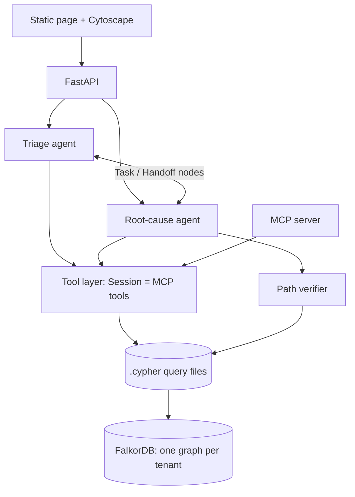

# Causeway

A team of agents that investigates a failing release in a synthetic company and backs every conclusion with a
verifiable path through a FalkorDB graph.

Built for [Graph Hacks](https://www.wemakedevs.org/hackathons/falkordb) by WeMakeDevs and FalkorDB.
**Tracks:** Agents That Act on Connected Data · Agent Memory and Coordination · Company Brain.
AI assistance is disclosed in [AI_DISCLOSURE.md](AI_DISCLOSURE.md).

## What it does
Pick an incident ("elevated timeouts in payments", "5xx errors in api-gateway"). Two agents work it through
FalkorDB only:
1. **Triage** opens a `Task`, finds entry points, traces dependencies, lists recent changes, recalls past
   conclusions from memory, and hands the task off.
2. **Root-cause** claims the task atomically, ranks suspect commits, looks up similar incidents, owners and
   design decisions, and produces claims. A deterministic **verifier** checks each claim's path against the
   graph; a claim whose path does not exist is marked unsupported.

The UI shows the agent steps, the ranked suspects, and the why-path in a Cytoscape graph (click a claim to
highlight it). "Confirm root cause" writes the episode to memory so the next incident of the same family is
ranked better.

## Why a graph
FalkorDB is the only datastore; without it the product does not work (`tests/test_graph_dependence.py`).
The answer to "what broke checkout?" is a *path*: failing service → dependency → changed service ← commit ← author.
Dependencies, ownership, history, decisions, memory and agent hand-offs are all edges in one graph, so evidence
for a claim is literally a list of node ids that can be re-checked.

## Quick start
Needs Docker and Python 3.11+.
```
make demo        # starts FalkorDB, creates indexes, seeds two tenants, serves http://127.0.0.1:8000
make test        # 86 tests (graph queries vs ground truth, verifier, memory, isolation, concurrency)
make eval        # flat RAG vs graph vs graph+memory, writes docs/RESULTS.md
python -m causeway.mcp_server   # the tools over MCP (stdio); tenant fixed by CAUSEWAY_TENANT
```
FalkorDB Browser: http://localhost:3100.

## Architecture


## Graph data model
See [docs/GRAPH_MODEL.md](docs/GRAPH_MODEL.md) for the diagram and rules. Three layers in one graph per tenant:
company brain (Person, Team, Service, Commit, PR, Test, Ticket, Incident, Decision, Doc, Thread), memory
(Episode, Belief with `valid_from`/`valid_to` and `SUPERSEDES`), and coordination (Agent, Task, Handoff).

## Cypher the product depends on
Every query is a file in [`causeway/graph/queries/`](causeway/graph/queries), parameterised, with a header
comment saying what it is for. Each is exercised by a test; the read tools are checked against the generated ground truth.

| file | purpose |
|---|---|
| [`all_commits_window.cypher`](causeway/graph/queries/all_commits_window.cypher) | every commit in the window before $as_of, with no graph structure used. |
| [`claim_task.cypher`](causeway/graph/queries/claim_task.cypher) | atomic task claim: status check and change in one write query, so only one agent can win. |
| [`commit_message.cypher`](causeway/graph/queries/commit_message.cypher) | the message of one commit by id. |
| [`decision_trace.cypher`](causeway/graph/queries/decision_trace.cypher) | why is a service built the way it is? |
| [`dependents.cypher`](causeway/graph/queries/dependents.cypher) | the reverse view. Which services call this one, up to $depth hops (who is hurt if it breaks). |
| [`edge_between.cypher`](causeway/graph/queries/edge_between.cypher) | does any relationship connect two nodes (either direction)? Used by the path verifier. |
| [`entry_points.cypher`](causeway/graph/queries/entry_points.cypher) | map free text (alert, log line) to services, via vector search over Docs. |
| [`handoff.cypher`](causeway/graph/queries/handoff.cypher) | pass an open task to another agent with a payload (JSON string of what was learned). |
| [`incident_context.cypher`](causeway/graph/queries/incident_context.cypher) | the starting facts of an investigation. |
| [`list_incidents.cypher`](causeway/graph/queries/list_incidents.cypher) | incidents for the picker, oldest first, with whether memory already holds a conclusion. |
| [`node_info.cypher`](causeway/graph/queries/node_info.cypher) | display label and name for a node id (used to draw why-paths in the UI). |
| [`open_task.cypher`](causeway/graph/queries/open_task.cypher) | the triage agent opens a unit of work for an investigation. |
| [`recall.cypher`](causeway/graph/queries/recall.cypher) | what do we already believe about past root causes? current beliefs (or full history) with the culprit commit they point at. |
| [`recent_changes.cypher`](causeway/graph/queries/recent_changes.cypher) | commits that touched a service or anything it depends on, in the window before $as_of. |
| [`remember_episode.cypher`](causeway/graph/queries/remember_episode.cypher) | record a finished investigation. idempotent (MERGE on ids) write of episode, belief and confirmed root cause. |
| [`service_features.cypher`](causeway/graph/queries/service_features.cypher) | per-service signals used when ranking suspect commits. |
| [`service_for_test.cypher`](causeway/graph/queries/service_for_test.cypher) | the service(s) a failing test covers. Exact match on the test name or id. |
| [`similar_incidents.cypher`](causeway/graph/queries/similar_incidents.cypher) | earlier incidents whose dependency neighbourhood overlaps this one's. |
| [`supersede_belief.cypher`](causeway/graph/queries/supersede_belief.cypher) | replace a current belief without deleting history. |
| [`trace_dependencies.cypher`](causeway/graph/queries/trace_dependencies.cypher) | what a service depends on, up to $depth hops (the blast-radius view for a failure). |
| [`who_knows.cypher`](causeway/graph/queries/who_knows.cypher) | who to ask about a service. |

Algorithms: variable-length traversal (`DEPENDS_ON*1..N`), vector search (`db.idx.vector.queryNodes`),
neighbourhood Jaccard overlap, transitive dependents count (blast radius). Ranking is in
[`causeway/ranking.py`](causeway/ranking.py): `recency × proximity × centrality × risk (× memory boost)`.

## Results
| system | top-1 | top-3 | easy top-1 | medium top-1 | hard top-1 | verified claims | mean ms |
|---|---|---|---|---|---|---|---|
| flat_rag | 0% | 17% | 0% | 0% | 0% | n/a (no graph path) | 1.4 |
| graph | 25% | 83% | 100% | 0% | 0% | 100% | 2.7 |
| graph+mem | 67% | 92% | 100% | 50% | 67% | 100% | 4.5 |

Learning curve (top-1 by how many times the incident family has occurred before):

| system | 1st occurrence | 2nd | 3rd |
|---|---|---|---|
| flat_rag | 0% | 0% | 0% |
| graph | 25% | 25% | 25% |
| graph+mem | 25% | 75% | 100% |

Real numbers from `make eval` on 12 seeded incidents (4 recurring families × 3). Details and caveats below.

## Tests
`tests/` covers: **path faithfulness** (fabricated paths rejected), **tenant isolation** (a beta session cannot
see alpha through any tool; no tool accepts a tenant argument), **concurrency** (20 racers claim one task: exactly
one wins; 50 parallel investigations with memory writes: no lost writes, no duplicate claims; p50 3.3 ms,
p95 6.9 ms per call), **supersession** (history kept, `recall` returns the current belief), and every query
against ground truth.

## Honest limitations
- **The agents are deterministic code, not LLM agents.** There are no Anthropic/LLM calls. The two "agents"
  coordinate through real Task/Handoff nodes and call the same tools an LLM agent would (also exposed over
  MCP), but the reasoning is graph queries plus a hand-set scoring function.
- **The synthetic data favours memory.** Incidents in a family share the same commit-message template, so
  recalled culprit messages are a strong signal. Expect a smaller memory gain on real data.
- **Small sample.** 12 incidents; percentages move 8 points per incident. No statistical claims.
- **The graph ranker is weak without memory on medium/hard incidents** (0% top-1): the generator plants decoy
  commits that are newer and closer than the real culprit. Top-3 is 83%. The scoring weights were set by hand
  and not tuned on these incidents.
- **Flat RAG baseline uses a hashed bag-of-words embedding**, not a neural embedding model, so its weakness is
  partly the stand-in. It is fair in being given the same 72-hour commit window, but not a best-effort RAG.
- Embeddings for the graph's vector index use the same stand-in (no model download).
- No hosted deployment; local setup only. The UI was syntax-checked and its API tested, but not exercised in
  a browser during development.

## Repo map
`causeway/` (graph, data generator, ranking, memory, tasks, investigate, MCP server, API, static UI) ·
`eval/` · `tests/` · `data/` (generated, deterministic) · `docs/` (graph model, design notes, progress, results).
