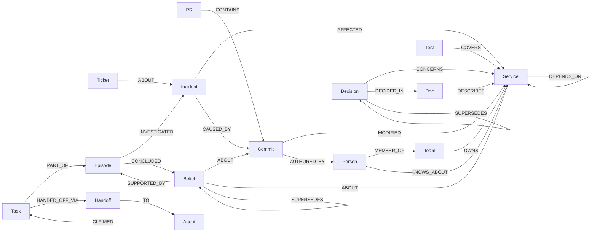

# Graph model

One FalkorDB graph per tenant (`tenant_alpha`, `tenant_beta`). Company knowledge, agent memory and agent
coordination all live in the same graph, so a path can cross from a failing service to a commit to a
person to a past decision.

**Layers**
- Company brain: Person, Team, Service, Commit, PR, Test, Ticket, Incident, Decision, Doc, Thread.
- Memory: Episode, Belief (valid_from / valid_to; superseded, never deleted).
- Coordination: Agent, Task, Handoff.

**Rules**
- Fact edges carry `valid_from`; a belief that is replaced gets `valid_to` and a `SUPERSEDES` edge from its successor.
- `Incident -[:CAUSED_BY]-> Commit` does **not** exist in the seeded graph (that would hand the agents the answer). It is written by `remember_episode` when a team confirms a root cause.
- Indexes: range index on `id` for every label, on `Incident.ts` and `Commit.ts`; vector index (384-dim, cosine) on `Doc.embedding` and `Belief.embedding`.
- Added to the original plan: `Incident.summary` (alert text) and `Doc.embedding` filled by a deterministic hashed bag-of-words stand-in.
